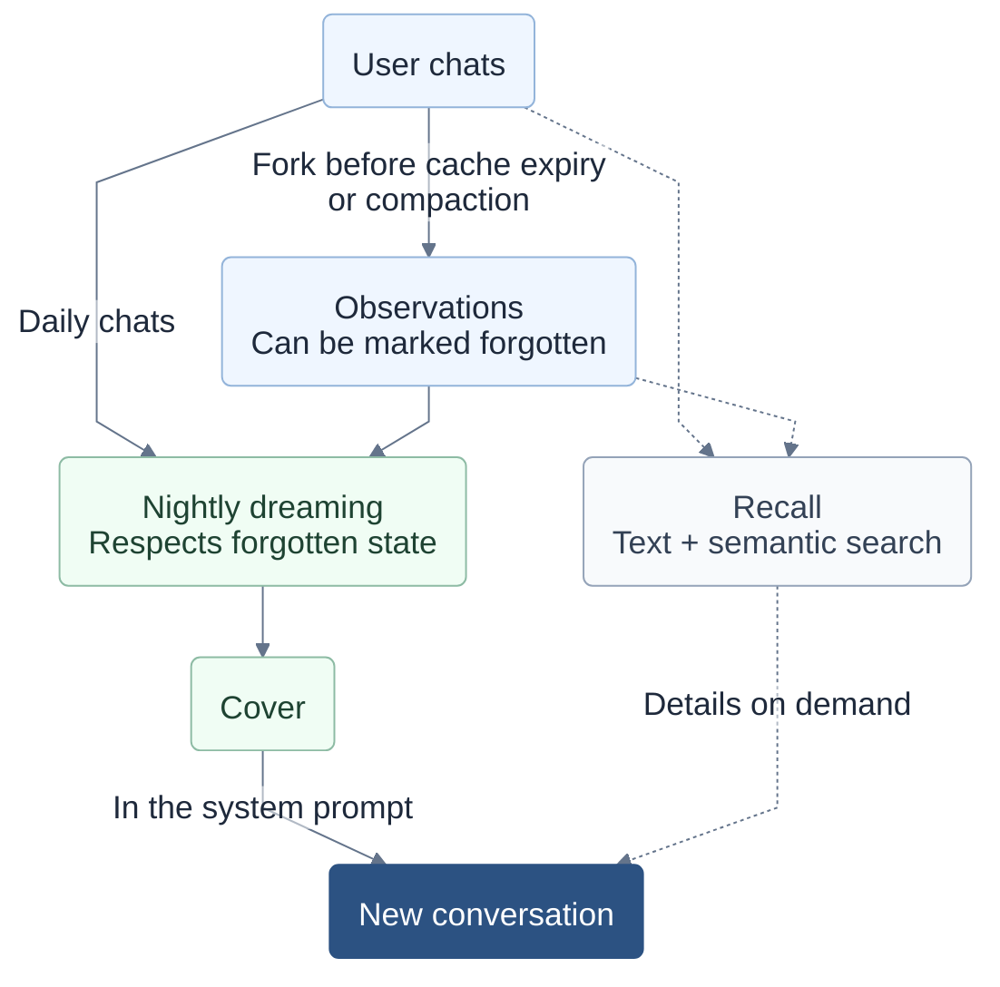
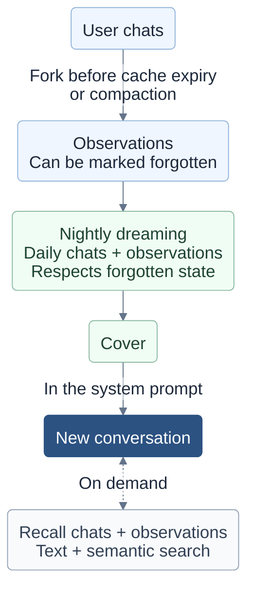

# Strawberry memory diagram

The blog uses pre-rendered SVGs so the diagram also works without JavaScript.
The first diagram shows the full data flow. The second is a narrow layout for
small screens, with the same inputs described inside the dreaming and recall nodes.

Regenerate both SVGs with Mermaid CLI 11.12.0:

```sh
mmdc -i src/diagrams/strawberry-memory.md -o .context/strawberry-memory.md -a static/blog/strawberry -b transparent
```

For an existing Chrome installation, pass `-p` with a Puppeteer configuration
containing its `executablePath` (and `args: ["--no-sandbox"]` in this sandbox).

## Wide layout: strawberry-memory-1.svg



## Narrow layout: strawberry-memory-2.svg


